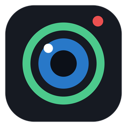

<p align="center"></p>

<h1 align="center">PhoneCam</h1>

<p align="center"><a href="README.md">Русский</a> · <b>English</b> · <a href="README.uk.md">Українська</a></p>

<p align="center">Your phone as a webcam for Windows and OBS. Free, no ads, no watermarks.<br>
<i>Android app, iPhone and any phone via Telegram / browser.</i></p>

<p align="center">
  <a href="https://github.com/convicted3/phonecam/releases/latest/download/PhoneCam-Windows.zip"></a>
  <a href="https://github.com/convicted3/phonecam/releases/latest/download/PhoneCam.apk"></a>
  <a href="https://t.me/phonecamweb_bot"></a>
</p>
<p align="center">
  <a href="https://github.com/convicted3/phonecam/releases/latest"></a>
  <a href="https://github.com/convicted3/phonecam/releases"></a>
  
  
  <a href="LICENSE"></a>
</p>

---

## Features

- **"PhoneCam" virtual webcam** - works in Discord, Zoom, Telegram, browsers and any other app.
- **OBS Studio plugin** (28+) - a separate source, works without the PC program.
- **Android app** (Android 5.0+): Wi-Fi or USB (adb), up to 1080p, up to 60 FPS
  (including an experimental 60 FPS mode via high-speed capture on phones whose normal mode gives only 30).
- **iPhone and any phone via Telegram or a browser** - nothing to install: the [@phonecamweb_bot](https://t.me/phonecamweb_bot) bot, a QR code on the PC screen, WebRTC.
- Flashlight, zoom, tap to focus, wide-angle camera, screen light for the front camera.
- **Smart Brightness** - rescues the picture in the dark: temporal and color noise reduction, local brightness correction.
- Picture settings on the PC: brightness, contrast, saturation, gamma, sharpness, temperature, exposure.
- Low latency: hardware H.264 on the phone, Media Foundation decoder on the PC, queue flushing when falling behind.
- Phone battery level in the program window and the tray menu, notifications at 15% and 5%.
- Dark and light theme, runs from the tray.
- English, Russian and Ukrainian interface (PC - in settings ⚙, phone and bot - phone language, OBS - OBS language).

## Install

1. **PC:** download [`PhoneCam-Windows.zip`](https://github.com/convicted3/phonecam/releases/latest/download/PhoneCam-Windows.zip), unpack it and run `Windows\PhoneCam.exe`.
2. **Android:** download [`PhoneCam.apk`](https://github.com/convicted3/phonecam/releases/latest/download/PhoneCam.apk) on the phone, install and open it.
   **iPhone / no app:** open the [@phonecamweb_bot](https://t.me/phonecamweb_bot) bot in Telegram.
3. In the PC program choose Wi-Fi, USB or Telegram and click "Connect".
4. Webcam for other apps: ⚙ → "Install webcam". OBS: run `OBS plugin\Установить в OBS.bat` (the plugin installer).

<details>
<summary><b>Windows says "The publisher could not be verified" on every launch</b></summary>

That's the "downloaded from the internet" mark. Right-click `PhoneCam.exe` → Properties → tick **Unblock** → OK.
Or unpack the archive with [7-Zip](https://7-zip.org) - then there is no mark.
</details>

<details>
<summary><b>Android won't install the APK</b></summary>

That's normal for apps outside Google Play: "More details" → "Install anyway".
If the phone asks, allow installs from this source (browser / Telegram).
</details>

<details>
<summary><b>USB connection (lower latency)</b></summary>

1. Enable "USB debugging" on the phone (Settings → About phone → tap "Build number" 7 times → Developer options).
2. Download [Android Platform Tools](https://developer.android.com/tools/releases/platform-tools) and put
   `adb.exe`, `AdbWinApi.dll`, `AdbWinUsbApi.dll` next to `PhoneCam.exe`.
3. Plug in the cable and choose "USB" in the program.
</details>

<details>
<summary><b>The phone isn't found over Wi-Fi</b></summary>

- Is the app open on the phone? Are the phone and the PC on the same Wi-Fi?
- Windows Firewall may have asked for permission - allow it for private networks.
- Guest networks and some routers don't let devices see each other (client isolation).
- Ports: TCP 5757 (video), UDP 5758 (phone discovery).
</details>

## How it works

| Part | Tech |
|---|---|
| `android/` | Java 8, Camera2 (+ constrained high-speed session), MediaCodec H.264, own TCP protocol. Built without Gradle: `javac` + `dx` + own Python generators for the manifest and resources |
| `pc/app/` | C++17, Win32 GDI (own controls), tray |
| `pc/core/` | Protocol client, Media Foundation decoder, low-light processing, WebRTC receiver (libdatachannel), QR codes, translations |
| `pc/obs-plugin/` | Async OBS source (NV12) |
| `third_party/softcam/` | DirectShow virtual camera (softcam, modified) |
| `web/` | Phone page for Telegram/browsers (getUserMedia + WebRTC) and the Cloudflare Worker with the bot |

Telegram/browser mode: the phone and the PC find each other through public MQTT brokers
(messages are AES-GCM encrypted with a key derived from the pairing code); video goes directly phone → PC over WebRTC.
The phone and the PC should be on the same network (or networks that allow a direct connection).

## Building

Everything builds on Linux.

**Windows part** (needs [zig](https://ziglang.org): `pip install ziglang`):
```
bash pc/build.sh        # -> pc/build/PhoneCam.exe, PhoneCamVirtual64/32.dll, phonecam-obs.dll
```

**Android** (needs JDK 11+, Python 3 + Pillow, zip):
```
bash android/build.sh   # -> android/build/PhoneCam.apk (android.jar and dx are downloaded automatically)
```

**Phone page / bot:**
```
python3 web/build_worker.py   # -> web/worker.js, paste into a Cloudflare Worker
```
For the bot, add a `BOT_TOKEN` secret (token from @BotFather) to the Worker and open `https://<worker>/setup`.

**Translations:** strings live in `i18n/pc_strings.py`, `i18n/android_strings.py`, `i18n/web_strings.py`
(Russian source text -> English, Ukrainian). After editing run `python3 i18n/gen.py`.

## License

MIT - see [LICENSE](LICENSE). Third-party components and their licenses: [THIRD_PARTY.md](THIRD_PARTY.md).
