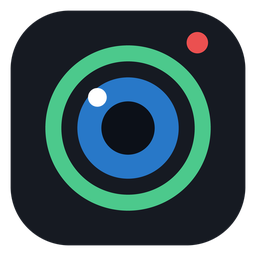

<p align="center"></p>

<h1 align="center">PhoneCam</h1>

<p align="center">Телефон как вебкамера для Windows и OBS. Бесплатно, без рекламы, без водяных знаков.<br>
<i>Free phone-as-webcam for Windows and OBS (Android app, iPhone via Telegram / browser).</i></p>

<p align="center">
  <a href="https://github.com/convicted3/phonecam/releases/latest/download/PhoneCam-Windows.zip"></a>
  <a href="https://github.com/convicted3/phonecam/releases/latest/download/PhoneCam.apk"></a>
  <a href="https://t.me/phonecamweb_bot"></a>
</p>
<p align="center">
  <a href="https://github.com/convicted3/phonecam/releases/latest"></a>
  <a href="https://github.com/convicted3/phonecam/releases"></a>
  
  
  <a href="LICENSE"></a>
</p>

---

## Возможности

- **Виртуальная вебка «PhoneCam»** - работает в Discord, Zoom, Telegram, браузере и любых программах.
- **Плагин для OBS Studio** (28+) - отдельный источник, можно без программы для ПК.
- **Android-приложение** (Android 5.0+): Wi-Fi или USB (adb), до 1080p, до 60 FPS
  (в том числе экспериментальный режим 60 FPS через скоростную съёмку на телефонах, где обычный режим даёт только 30).
- **iPhone и любой телефон через Телеграм или браузер** - без установки приложения: бот [@phonecamweb_bot](https://t.me/phonecamweb_bot), QR-код на экране ПК, WebRTC.
- Фонарик, зум, фокус по нажатию, широкоугольная камера, подсветка экраном для фронтальной камеры.
- **Умная яркость** - вытягивает картинку в темноте: шумоподавление во времени и по цвету, локальная коррекция яркости.
- Настройки картинки на ПК: яркость, контраст, насыщенность, гамма, резкость, температура, экспозиция.
- Низкая задержка: аппаратное H.264 на телефоне, декодер Media Foundation на ПК, сброс очереди при отставании.
- Заряд батареи телефона в окне программы и в меню трея, уведомление при 15% и 5%.
- Тёмная и светлая тема, работа из трея.

## Установка

1. **ПК:** скачай [`PhoneCam-Windows.zip`](https://github.com/convicted3/phonecam/releases/latest/download/PhoneCam-Windows.zip), распакуй и запусти `Windows\PhoneCam.exe`.
2. **Android:** скачай на телефон [`PhoneCam.apk`](https://github.com/convicted3/phonecam/releases/latest/download/PhoneCam.apk), установи и открой.
   **iPhone / без приложения:** открой бота [@phonecamweb_bot](https://t.me/phonecamweb_bot) в Телеграме.
3. В программе на ПК выбери Wi-Fi, USB или Телеграм и нажми «Подключить».
4. Вебка для других программ: ⚙ → «Установить вебку». OBS: `OBS plugin\Установить в OBS.bat`.

<details>
<summary><b>Windows пишет «Не удаётся проверить издателя» при каждом запуске</b></summary>

Это пометка «скачано из интернета». Правой кнопкой по `PhoneCam.exe` → Свойства → галочка **Разблокировать** → ОК.
Или распакуй архив через [7-Zip](https://7-zip.org) - тогда пометки не будет.
</details>

<details>
<summary><b>Android не даёт установить APK</b></summary>

Это нормально для приложений не из Google Play: «Подробнее» → «Всё равно установить».
Если телефон спросит - разреши установку из этого источника (браузер / Телеграм).
</details>

<details>
<summary><b>Подключение по USB (меньше задержка)</b></summary>

1. На телефоне включи «Отладку по USB» (Настройки → О телефоне → 7 раз «Номер сборки» → Для разработчиков).
2. Скачай [Android Platform Tools](https://developer.android.com/tools/releases/platform-tools) и положи
   `adb.exe`, `AdbWinApi.dll`, `AdbWinUsbApi.dll` рядом с `PhoneCam.exe`.
3. Подключи кабель, выбери «USB» в программе.
</details>

<details>
<summary><b>Телефон не находится по Wi-Fi</b></summary>

- Приложение на телефоне открыто? Телефон и ПК в одной Wi-Fi сети?
- Брандмауэр Windows мог спросить разрешение - разреши для частных сетей.
- Гостевые сети и некоторые роутеры не дают устройствам видеть друг друга (изоляция клиентов).
- Порты: TCP 5757 (видео), UDP 5758 (поиск телефона).
</details>

## Как это устроено

| Часть | Технологии |
|---|---|
| `android/` | Java 8, Camera2 (+ constrained high-speed session), MediaCodec H.264, свой TCP-протокол. Сборка без Gradle: `javac` + `dx` + свои генераторы манифеста и ресурсов на Python |
| `pc/app/` | C++17, Win32 GDI (свои контролы), трей |
| `pc/core/` | Клиент протокола, декодер Media Foundation, ночная обработка, WebRTC-приём (libdatachannel), QR-коды |
| `pc/obs-plugin/` | Асинхронный источник OBS (NV12) |
| `third_party/softcam/` | Виртуальная камера DirectShow (softcam, доработан) |
| `web/` | Страница телефона для Телеграма/браузера (getUserMedia + WebRTC) и Cloudflare Worker с ботом |

Режим Телеграм/браузер: телефон и ПК находят друг друга через публичные MQTT-брокеры
(сообщения зашифрованы AES-GCM ключом из кода сопряжения), видео идёт напрямую телефон → ПК по WebRTC.
Телефон и ПК должны быть в одной сети (или в сетях, где проходит прямое соединение).

## Сборка

Всё собирается на Linux.

**Windows-часть** (нужен [zig](https://ziglang.org): `pip install ziglang`):
```
bash pc/build.sh        # -> pc/build/PhoneCam.exe, PhoneCamVirtual64/32.dll, phonecam-obs.dll
```

**Android** (нужны JDK 11+, Python 3 + Pillow, zip):
```
bash android/build.sh   # -> android/build/PhoneCam.apk (android.jar и dx скачаются сами)
```

**Страница телефона / бот:**
```
python3 web/build_worker.py   # -> web/worker.js, вставить в Cloudflare Worker
```
Для бота добавь в Worker секрет `BOT_TOKEN` (токен от @BotFather) и открой `https://<worker>/setup`.

## Лицензия

MIT - см. [LICENSE](LICENSE). Сторонние компоненты и их лицензии - в [THIRD_PARTY.md](THIRD_PARTY.md).
