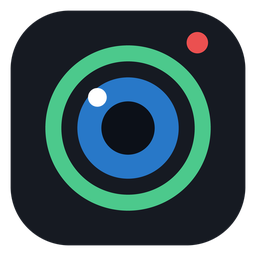

<p align="center"></p>

<h1 align="center">PhoneCam</h1>

<p align="center"><a href="README.md">Русский</a> · <a href="README.en.md">English</a> · <b>Українська</b></p>

<p align="center">Телефон як вебкамера для Windows і OBS. Безкоштовно, без реклами, без водяних знаків.<br>
<i>Застосунок для Android, iPhone і будь-який телефон через Телеграм / браузер.</i></p>

<p align="center">
  <a href="https://github.com/convicted3/phonecam/releases/latest/download/PhoneCam-Windows.zip"></a>
  <a href="https://github.com/convicted3/phonecam/releases/latest/download/PhoneCam.apk"></a>
  <a href="https://t.me/phonecamweb_bot"></a>
</p>
<p align="center">
  <a href="https://github.com/convicted3/phonecam/releases/latest"></a>
  <a href="https://github.com/convicted3/phonecam/releases"></a>
  
  
  <a href="LICENSE"></a>
</p>

---

## Можливості

- **Віртуальна вебка «PhoneCam»** - працює в Discord, Zoom, Telegram, браузері та будь-яких програмах.
- **Плагін для OBS Studio** (28+) - окреме джерело, можна без програми для ПК.
- **Застосунок для Android** (Android 5.0+): Wi-Fi або USB (adb), до 1080p, до 60 FPS
  (зокрема експериментальний режим 60 FPS через швидкісну зйомку на телефонах, де звичайний режим дає лише 30).
- **iPhone і будь-який телефон через Телеграм або браузер** - без встановлення застосунку: бот [@phonecamweb_bot](https://t.me/phonecamweb_bot), QR-код на екрані ПК, WebRTC.
- Ліхтарик, зум, фокус дотиком, ширококутна камера, підсвітка екраном для фронтальної камери.
- **Розумна яскравість** - витягує картинку в темряві: шумозаглушення в часі й за кольором, локальна корекція яскравості.
- Налаштування картинки на ПК: яскравість, контраст, насиченість, гамма, різкість, температура, експозиція.
- Низька затримка: апаратний H.264 на телефоні, декодер Media Foundation на ПК, скидання черги при відставанні.
- Заряд батареї телефона у вікні програми та в меню трею, сповіщення при 15% і 5%.
- Темна і світла тема, робота з трею.
- Інтерфейс українською, англійською та російською (ПК - у налаштуваннях ⚙, телефон і бот - за мовою телефона, OBS - за мовою OBS).

## Встановлення

1. **ПК:** завантаж [`PhoneCam-Windows.zip`](https://github.com/convicted3/phonecam/releases/latest/download/PhoneCam-Windows.zip), розпакуй і запусти `Windows\PhoneCam.exe`.
2. **Android:** завантаж на телефон [`PhoneCam.apk`](https://github.com/convicted3/phonecam/releases/latest/download/PhoneCam.apk), встанови й відкрий.
   **iPhone / без застосунку:** відкрий бота [@phonecamweb_bot](https://t.me/phonecamweb_bot) у Телеграмі.
3. У програмі на ПК обери Wi-Fi, USB або Телеграм і натисни «Підключити».
4. Вебка для інших програм: ⚙ → «Встановити вебку». OBS: `OBS plugin\Install OBS plugin.bat` (видалити - `Uninstall OBS plugin.bat`).

<details>
<summary><b>Windows пише «Не вдалося перевірити видавця» при кожному запуску</b></summary>

Це позначка «завантажено з інтернету». Правою кнопкою по `PhoneCam.exe` → Властивості → галочка **Розблокувати** → ОК.
Або розпакуй архів через [7-Zip](https://7-zip.org) - тоді позначки не буде.
</details>

<details>
<summary><b>Android не дає встановити APK</b></summary>

Це нормально для застосунків не з Google Play: «Докладніше» → «Усе одно встановити».
Якщо телефон запитає - дозволь встановлення з цього джерела (браузер / Телеграм).
</details>

<details>
<summary><b>Підключення по USB (менша затримка)</b></summary>

1. На телефоні увімкни «Налагодження по USB» (Налаштування → Про телефон → 7 разів «Номер збірки» → Для розробників).
2. Завантаж [Android Platform Tools](https://developer.android.com/tools/releases/platform-tools) і поклади
   `adb.exe`, `AdbWinApi.dll`, `AdbWinUsbApi.dll` поруч із `PhoneCam.exe`.
3. Підключи кабель, обери «USB» у програмі.
</details>

<details>
<summary><b>Телефон не знаходиться по Wi-Fi</b></summary>

- Застосунок на телефоні відкрито? Телефон і ПК в одній Wi-Fi мережі?
- Брандмауер Windows міг запитати дозвіл - дозволь для приватних мереж.
- Гостьові мережі та деякі роутери не дають пристроям бачити одне одного (ізоляція клієнтів).
- Порти: TCP 5757 (відео), UDP 5758 (пошук телефона).
</details>

## Як це влаштовано

| Частина | Технології |
|---|---|
| `android/` | Java 8, Camera2 (+ constrained high-speed session), MediaCodec H.264, власний TCP-протокол. Збірка без Gradle: `javac` + `dx` + власні генератори маніфесту й ресурсів на Python |
| `pc/app/` | C++17, Win32 GDI (власні контроли), трей |
| `pc/core/` | Клієнт протоколу, декодер Media Foundation, нічна обробка, WebRTC-прийом (libdatachannel), QR-коди, переклади |
| `pc/obs-plugin/` | Асинхронне джерело OBS (NV12) |
| `third_party/softcam/` | Віртуальна камера DirectShow (softcam, доопрацьований) |
| `web/` | Сторінка телефона для Телеграма/браузера (getUserMedia + WebRTC) і Cloudflare Worker з ботом |

Режим Телеграм/браузер: телефон і ПК знаходять одне одного через публічні MQTT-брокери
(повідомлення зашифровані AES-GCM ключем із коду сполучення), відео йде напряму телефон → ПК через WebRTC.
Телефон і ПК мають бути в одній мережі (або в мережах, де проходить пряме з'єднання).

## Збірка

Усе збирається на Linux.

**Windows-частина** (потрібен [zig](https://ziglang.org): `pip install ziglang`):
```
bash pc/build.sh        # -> pc/build/PhoneCam.exe, PhoneCamVirtual64/32.dll, phonecam-obs.dll
```

**Android** (потрібні JDK 11+, Python 3 + Pillow, zip):
```
bash android/build.sh   # -> android/build/PhoneCam.apk (android.jar і dx завантажаться самі)
```

**Сторінка телефона / бот:**
```
python3 web/build_worker.py   # -> web/worker.js, вставити в Cloudflare Worker
```
Для бота додай у Worker секрет `BOT_TOKEN` (токен від @BotFather) і відкрий `https://<worker>/setup`.

**Переклади:** рядки лежать у `i18n/pc_strings.py`, `i18n/android_strings.py`, `i18n/web_strings.py`
(російський текст -> англійська, українська). Після правки: `python3 i18n/gen.py`.

## Підпис коду та конфіденційність

[Політика підпису коду](CODE_SIGNING_POLICY.md) (Code signing policy) · [Політика конфіденційності](PRIVACY.md)

## Ліцензія

MIT - див. [LICENSE](LICENSE). Сторонні компоненти та їхні ліцензії - у [THIRD_PARTY.md](THIRD_PARTY.md).
